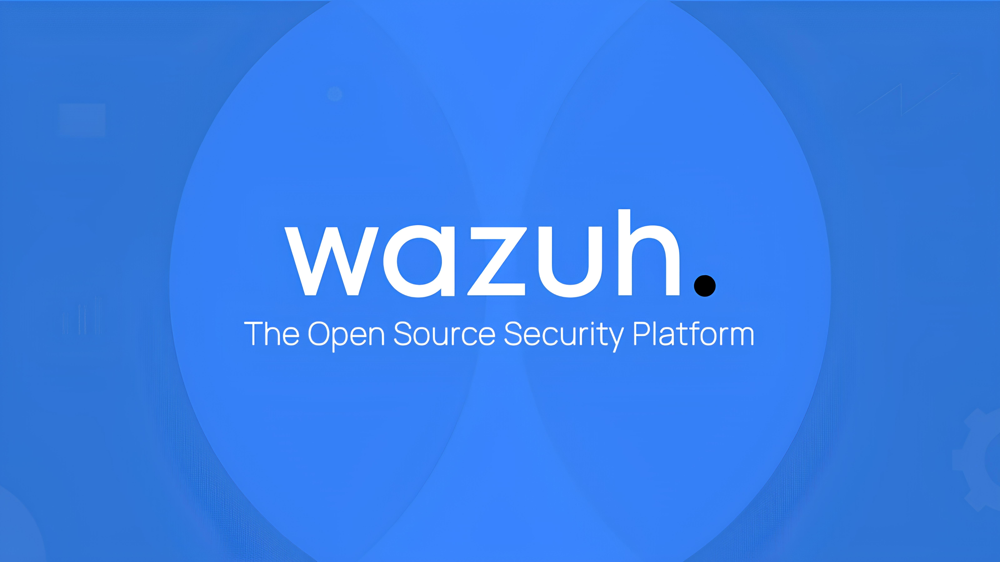
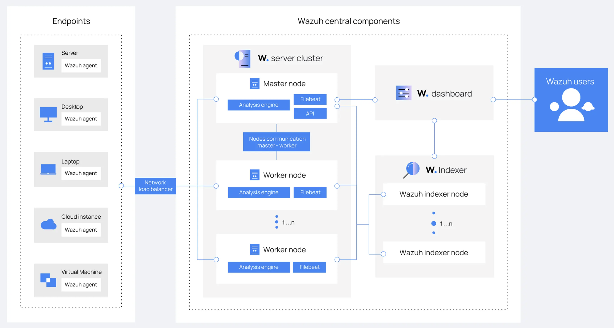
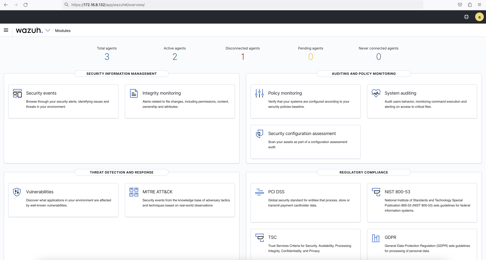
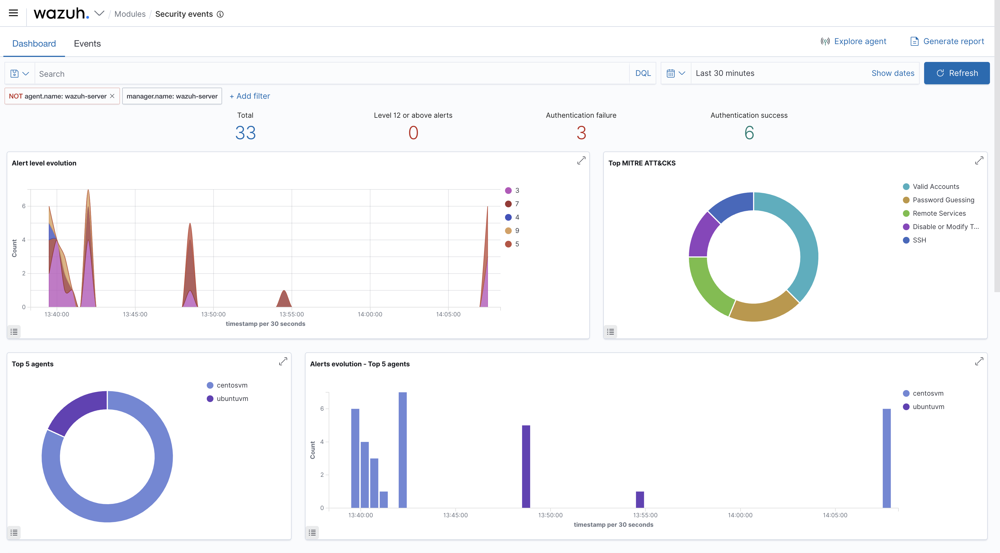
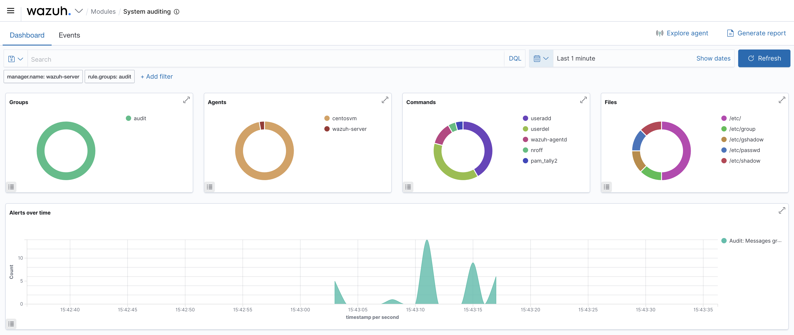
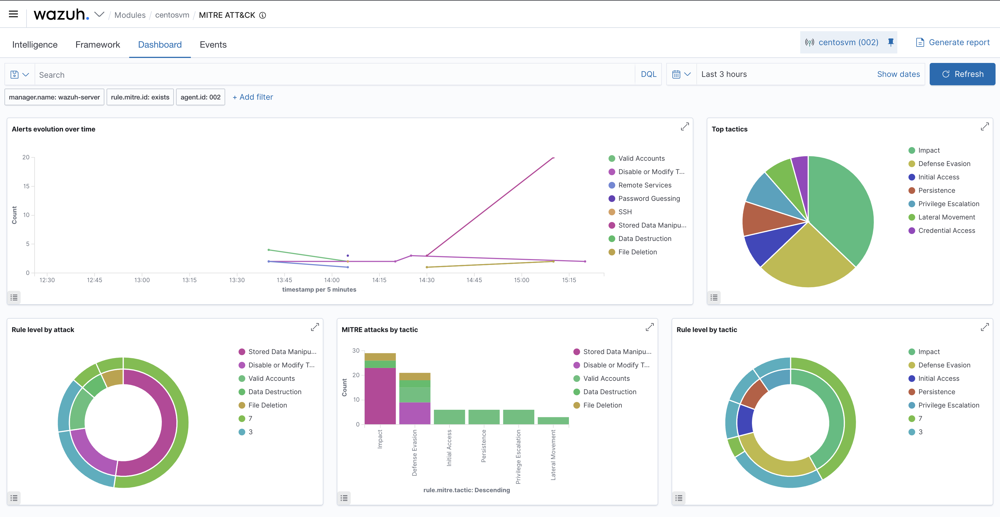
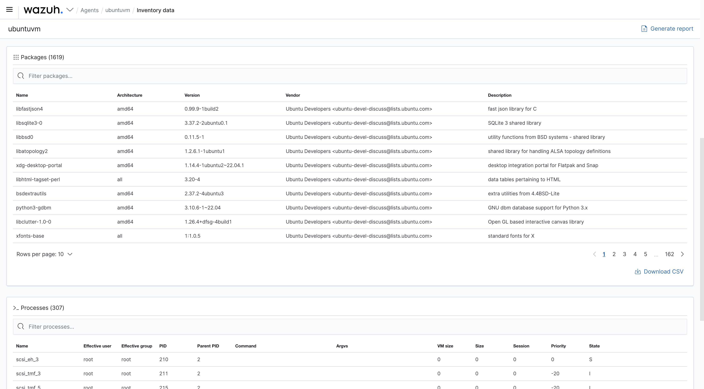

# Wazuh SIEM — Deployment, Threat Detection & Security Monitoring

> An end-to-end, hands-on deployment of **Wazuh**, the open-source SIEM/XDR platform, built in
> a virtual lab to practise real-world **blue-team** security monitoring: centralized log
> collection from Windows and Linux endpoints, custom detection rules and decoders, file
> integrity monitoring, system auditing, **MITRE ATT&CK** alert mapping, and **PCI DSS**
> compliance reporting — validated by simulating attacks and confirming the alerts they raise.

<p align="center">
  
</p>

---

## Table of Contents

- [Overview](#overview)
- [What This Project Demonstrates](#what-this-project-demonstrates)
- [Lab Architecture](#lab-architecture)
- [Wazuh Components](#wazuh-components)
- [Deployment Summary](#deployment-summary)
- [Capabilities Walkthrough](#capabilities-walkthrough)
  - [1. Modules Overview](#1-modules-overview)
  - [2. Security Events & Correlation](#2-security-events--correlation)
  - [3. File Integrity Monitoring (FIM)](#3-file-integrity-monitoring-fim)
  - [4. System Auditing](#4-system-auditing)
  - [5. MITRE ATT&CK Mapping](#5-mitre-attck-mapping)
  - [6. PCI DSS Compliance](#6-pci-dss-compliance)
  - [7. Inventory & Vulnerability Data](#7-inventory--vulnerability-data)
  - [8. Threat Simulation & Detection](#8-threat-simulation--detection)
- [Custom Rules & Decoders](#custom-rules--decoders)
- [Repository Structure](#repository-structure)
- [Documentation](#documentation)
- [Tech Stack](#tech-stack)
- [Skills Demonstrated](#skills-demonstrated)
- [References](#references)
- [Author](#author)
- [License](#license)

---

## Overview

**Security Information and Event Management (SIEM)** platforms give defenders a single place to
collect, normalize, correlate, and act on security telemetry from across an environment.
[**Wazuh**](https://wazuh.com/) is a free, open-source SIEM/XDR that unifies log analysis,
intrusion detection, file integrity monitoring, vulnerability detection, configuration
assessment, and regulatory compliance into one platform, managed from a single web dashboard.

This project documents a full deployment of Wazuh in a virtualized lab and the operational
workflows a SOC analyst runs on top of it. A Wazuh server (manager + indexer + dashboard) was
installed on a Linux host, and Wazuh agents were enrolled from both **Windows** and **Linux**
endpoints for centralized monitoring. From there, logs were collected and parsed, custom
detection logic was authored, attacks were simulated, and the resulting alerts were triaged,
mapped to MITRE ATT&CK, and checked against PCI DSS requirements.

The aim is to show the complete blue-team loop — **collect → normalize → detect → correlate →
alert → investigate → report** — on a production-grade open-source stack.

## What This Project Demonstrates

- **Platform deployment** — installing and configuring the Wazuh central components and
  enrolling multi-OS agents (Windows + Linux).
- **Log collection & aggregation** — unified ingestion of Windows Event Logs, Linux syslog /
  auditd, and application logs into a single searchable index.
- **Custom log parsing** — decoders and rules to extract security-relevant fields from
  non-standard logs.
- **Rule writing & correlation** — authoring custom rules and correlation logic to flag brute
  force, privilege changes, policy violations, and attack indicators.
- **Threat detection & response** — simulating real-world attacks (SSH brute force, file
  tampering, account abuse) and validating alert generation.
- **Framework-based analysis** — mapping alerts to **MITRE ATT&CK** tactics and techniques.
- **Compliance reporting** — tracking controls against **PCI DSS** (and other built-in
  frameworks: NIST 800-53, GDPR, HIPAA, TSC).
- **Dashboard operations** — using the Wazuh dashboard to visualize events, pivot across
  agents, and generate reports.

## Lab Architecture

| Role | Host | Purpose |
|---|---|---|
| **Wazuh Server** (`wazuh-server`) | Linux VM | Manager + Indexer + Dashboard (all-in-one) |
| **Linux Agent** (`ubuntuvm`) | Ubuntu 22.04 VM | Monitored endpoint — syslog, auditd, FIM, inventory |
| **Linux Agent** (`centosvm`) | CentOS VM | Monitored endpoint — FIM, MITRE/PCI test workloads |
| **Windows Agent** | Windows VM | Monitored endpoint — Windows Event Log, Sysmon-style telemetry |

All hosts run on an isolated internal/host-only network. Agents connect to the manager over the
encrypted agent channel (TCP/UDP **1514**) and enroll via the registration service (TCP **1515**).
The dashboard is served over HTTPS (**443**) and the Wazuh API listens on **55000**.

> See **[docs/architecture.md](docs/architecture.md)** for the full component and data-flow
> breakdown and **[docs/deployment-guide.md](docs/deployment-guide.md)** for the step-by-step
> install.

## Wazuh Components

<p align="center">
  
</p>

| Component | Function |
|---|---|
| **Wazuh Agent** | Lightweight endpoint collector — ships logs, FIM events, inventory, and runs SCA checks. Installed on servers, desktops, laptops, cloud instances, and VMs. |
| **Wazuh Manager (Server)** | The analysis engine — decodes incoming events, matches them against rules, generates alerts, and manages agents. Ships alerts to the indexer via Filebeat. |
| **Wazuh Indexer** | Scalable full-text search and analytics engine that stores and indexes alerts and events (OpenSearch-based). |
| **Wazuh Dashboard** | Web UI for visualization, investigation, rule management, compliance views, and reporting. |

## Deployment Summary

The Wazuh central components were installed with the official quickstart (single-node, all-in-one):

```bash
curl -sO https://packages.wazuh.com/4.x/wazuh-install.sh
sudo bash ./wazuh-install.sh -a
```

Agents were then enrolled from each endpoint and verified as **Active** on the dashboard.
Full, copy-paste commands for the server and for Linux/Windows agents are in
**[docs/deployment-guide.md](docs/deployment-guide.md)**, and the agent/manager configuration
snippets used here live in **[config/](config/)**.

## Capabilities Walkthrough

### 1. Modules Overview

The Wazuh dashboard groups its capabilities into modules across four categories — Security
Information Management, Threat Detection & Response, Auditing & Policy Monitoring, and
Regulatory Compliance.

<p align="center">
  
</p>

The header tiles track fleet health at a glance — **total / active / disconnected / pending /
never-connected** agents.

### 2. Security Events & Correlation

The **Security Events** module is the analyst's primary view: every decoded event matched to a
rule, with severity (rule level), MITRE technique, and source agent. Summary tiles surface
**total alerts, level-12+ alerts, and authentication success vs. failure**.

<p align="center">
  
</p>

Visualizations include **alert level evolution**, **top MITRE ATT&CK techniques** (Valid
Accounts, Password Guessing, Remote Services, SSH …), and **top agents** by alert volume —
making it easy to spot which host is noisiest and why.

### 3. File Integrity Monitoring (FIM)

The **Integrity Monitoring** module (powered by `syscheck`) watches critical files and
directories and alerts on **added / modified / deleted** files, reporting changes to content,
permissions, ownership, and attributes.

<p align="center">
  
</p>

Here, changes to files under a monitored `/data` directory on the `centosvm` agent are tracked
by action, affected path, and the user responsible. The FIM configuration used is in
**[config/ossec.conf.linux.xml](config/ossec.conf.linux.xml)** — see
**[docs/file-integrity-monitoring.md](docs/file-integrity-monitoring.md)**.

### 4. System Auditing

Integrated with the Linux **Audit** subsystem (`auditd`), the **System Auditing** module tracks
user behaviour, command execution, and access to critical files.

<p align="center">
  
</p>

The dashboard breaks events down by **command** (`useradd`, `userdel`, `pam_tally2`, …) and
**file** (`/etc/passwd`, `/etc/shadow`, `/etc/group`, …), giving clear visibility into account
and privilege activity. Audit rules are documented in
**[docs/system-auditing.md](docs/system-auditing.md)**.

### 5. MITRE ATT&CK Mapping

Wazuh enriches rules with **MITRE ATT&CK** technique IDs, so alerts are automatically mapped to
adversary tactics and techniques for behaviour-based analysis.

<p align="center">
  
</p>

The module charts **top tactics** (Impact, Defense Evasion, Initial Access, Persistence,
Privilege Escalation, Lateral Movement, Credential Access) and techniques (Valid Accounts,
Password Guessing, Stored Data Manipulation, Data Destruction …), turning raw alerts into a
structured picture of adversary behaviour. See
**[docs/threat-detection-mitre.md](docs/threat-detection-mitre.md)**.

### 6. PCI DSS Compliance

Wazuh tags qualifying rules with the **PCI DSS** requirements they satisfy, producing a live
compliance view instead of a point-in-time audit.

<p align="center">
  
</p>

Requirements such as **10.2.x / 10.6.1** (audit trails and log review) and **11.2.x / 11.5**
(vulnerability scanning and change detection) are populated directly from FIM, vulnerability,
and audit events. The same engine also drives the **NIST 800-53**, **GDPR**, **TSC**, and
**HIPAA** views. See **[docs/compliance-pci-dss.md](docs/compliance-pci-dss.md)**.

### 7. Inventory & Vulnerability Data

Each agent reports a full software/hardware **inventory** — installed packages, running
processes, open ports, network interfaces, and users — which the vulnerability detector then
correlates against CVE feeds.

<p align="center">
  
</p>

In this lab the `ubuntuvm` agent reported **1,619 installed packages** and **307 running
processes**, all queryable and exportable from the dashboard — the raw material for both
vulnerability detection and incident investigation.

### 8. Threat Simulation & Detection

Detection logic is only trustworthy once it's tested. Attacks were simulated against the agents
and the resulting alerts verified on the dashboard — for example, an **SSH brute-force** burst
producing a spike of **authentication failures** mapped to *Password Guessing / Brute Force /
Valid Accounts*.

<p align="center">
  
</p>

The simulation workflow (brute force, FIM tampering, account abuse) is scripted in
**[scripts/simulate_attacks.sh](scripts/simulate_attacks.sh)** and explained in
**[docs/threat-simulation.md](docs/threat-simulation.md)**.

## Custom Rules & Decoders

Beyond Wazuh's thousands of out-of-the-box rules, this project adds custom detection logic to
show rule/decoder authoring:

- **`config/local_decoder.xml`** — a sample decoder that extracts fields from a non-standard
  application log.
- **`config/local_rules.xml`** — custom rules and a correlation rule that escalates repeated
  authentication failures from the same source into a single high-severity **brute-force**
  alert (using `frequency` / `timeframe`).

See **[docs/custom-rules.md](docs/custom-rules.md)** and
**[docs/log-collection-and-decoders.md](docs/log-collection-and-decoders.md)** for the full
walkthrough.

## Repository Structure

```
.
├── README.md                     # This file
├── LICENSE                       # MIT License
├── CITATION.cff                  # Citation metadata
├── CONTRIBUTING.md               # Contribution / lab-reproduction notes
├── .gitignore
├── assets/
│   └── images/                   # Dashboard screenshots & diagrams
├── config/
│   ├── ossec.conf.linux.xml      # Linux agent: FIM + auditd + log collection
│   ├── ossec.conf.windows.xml    # Windows agent: Event Log + FIM
│   ├── local_decoder.xml         # Custom decoder example
│   └── local_rules.xml           # Custom + correlation rules (brute force, etc.)
├── docs/
│   ├── architecture.md
│   ├── deployment-guide.md
│   ├── log-collection-and-decoders.md
│   ├── custom-rules.md
│   ├── file-integrity-monitoring.md
│   ├── system-auditing.md
│   ├── threat-detection-mitre.md
│   ├── compliance-pci-dss.md
│   └── threat-simulation.md
└── scripts/
    ├── install_wazuh_server.sh   # All-in-one server install (quickstart)
    ├── install_agent_linux.sh    # Enroll a Linux agent
    ├── install_agent_windows.ps1 # Enroll a Windows agent
    ├── simulate_attacks.sh       # Detection-validation lab attacks
    └── README.md
```

## Documentation

| Document | Contents |
|---|---|
| [architecture.md](docs/architecture.md) | Components, data flow, ports, lab topology |
| [deployment-guide.md](docs/deployment-guide.md) | Server install + Windows/Linux agent enrollment |
| [log-collection-and-decoders.md](docs/log-collection-and-decoders.md) | Log sources, decoders, custom parsing |
| [custom-rules.md](docs/custom-rules.md) | Rule syntax, custom rules, brute-force correlation |
| [file-integrity-monitoring.md](docs/file-integrity-monitoring.md) | `syscheck` config and FIM testing |
| [system-auditing.md](docs/system-auditing.md) | `auditd` integration and audit rules |
| [threat-detection-mitre.md](docs/threat-detection-mitre.md) | MITRE ATT&CK mapping and tactics |
| [compliance-pci-dss.md](docs/compliance-pci-dss.md) | PCI DSS and other compliance frameworks |
| [threat-simulation.md](docs/threat-simulation.md) | Attack simulation and alert validation |

## Tech Stack

**Wazuh** (Manager · Indexer · Dashboard · Agent) · **Filebeat** · **OpenSearch** ·
**auditd** · **Windows Event Log** · **Linux** (Ubuntu / CentOS) · **Windows** ·
**MITRE ATT&CK** · **PCI DSS / NIST 800-53 / GDPR / TSC** · **VirtualBox/VMware** (lab).

## Skills Demonstrated

`SIEM` · `Security Monitoring` · `Log Analysis` · `Threat Detection` · `Threat Hunting` ·
`Incident Response` · `Rule & Decoder Writing` · `Detection Engineering` ·
`File Integrity Monitoring` · `System Auditing` · `MITRE ATT&CK` · `Compliance (PCI DSS)` ·
`Blue Team` · `Dashboard Analytics`

## References

- Wazuh Documentation — https://documentation.wazuh.com/
- Wazuh Ruleset & rules syntax — https://documentation.wazuh.com/current/user-manual/ruleset/
- File Integrity Monitoring (syscheck) — https://documentation.wazuh.com/current/user-manual/capabilities/file-integrity/
- System auditing with auditd — https://documentation.wazuh.com/current/user-manual/capabilities/system-calls-monitoring/
- MITRE ATT&CK® — https://attack.mitre.org/
- PCI DSS — https://www.pcisecuritystandards.org/

## License

Released under the **MIT License** — see [LICENSE](LICENSE). Educational and defensive
security research use. All testing was performed in an isolated lab on systems owned by the
author.
