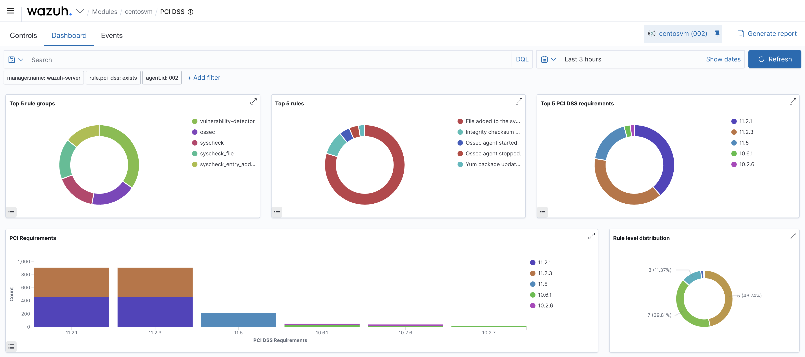

# Compliance — PCI DSS (and friends)

Wazuh tags qualifying rules with the regulatory controls they help satisfy, producing a **live
compliance view** instead of a once-a-year point-in-time audit. The same alert that detects a
file change or a failed login also counts toward the relevant PCI DSS, NIST 800-53, GDPR, TSC,
or HIPAA requirement.

<p align="center">
  
</p>

## How it works

Rules carry compliance groups, e.g.:

```xml
<group>authentication_failures,attack,pci_dss_11.4,</group>
```

Any alert from that rule is automatically attributed to **PCI DSS 11.4**. The dashboard then
rolls those tags up per requirement, so coverage is continuous and evidence-backed.

## What the dashboard shows

From the lab (agent `centosvm`):

- **Top rule groups** — `vulnerability-detector`, `ossec`, `syscheck`, `syscheck_file`,
  `syscheck_entry_added` — i.e. compliance here is driven mainly by FIM and vulnerability data.
- **Top rules** — "File added to the system", "Integrity checksum changed", "Ossec agent
  started/stopped", "Yum package updated".
- **Top PCI DSS requirements** — **11.2.1**, **11.2.3**, **11.5**, **10.6.1**, **10.2.6**.
- **Rule level distribution** — mostly level 5 (≈47%) and level 7 (≈40%), with a smaller band of
  level 3.

## Requirements exercised

| Requirement | Theme | Fed by |
|---|---|---|
| **10.2.x** | Audit trails for access & privileged actions | System Auditing (`auditd`) |
| **10.6.1** | Review logs/security events | Security Events pipeline |
| **11.2.1 / 11.2.3** | Internal vulnerability scanning | Vulnerability Detector |
| **11.4** | Intrusion detection / alerting | Brute-force & attack rules |
| **11.5** | Change detection on critical files | File Integrity Monitoring |

## Other frameworks

The same engine populates the **NIST 800-53**, **GDPR**, **TSC**, and **HIPAA** modules — a rule
tagged `gdpr_IV_35.7.d` and `pci_dss_10.2.5`, for instance, contributes to both views at once.
Switch frameworks from the **Regulatory Compliance** section of the Modules overview
([`03-modules-overview.png`](../assets/images/03-modules-overview.png)).

## Reporting

Every module — including the compliance dashboards — has a **Generate report** button that
exports a timestamped PDF for the selected agent and time range, which is handy as audit
evidence. Reports are excluded from version control by [`.gitignore`](../.gitignore).

## Why this matters

Compliance frameworks require *demonstrable, ongoing* monitoring — not a snapshot. Because Wazuh
derives compliance status from the same real-time alerts used for detection, a single deployment
serves both the SOC and the auditor, with the evidence trail already in place.
