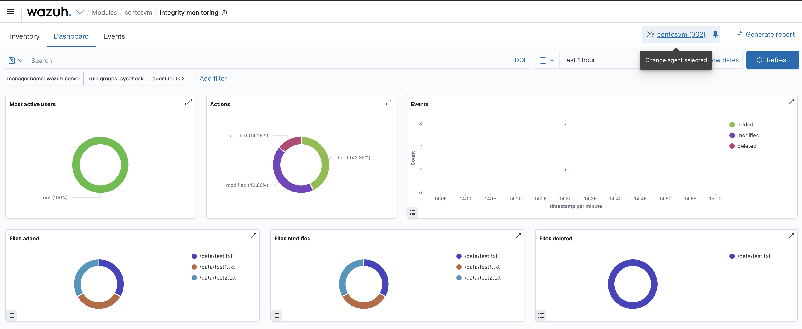

# File Integrity Monitoring (FIM)

Wazuh's **FIM** engine (`syscheck`) watches selected files and directories and alerts whenever
something is **added, modified, or deleted** — including changes to content, permissions,
ownership, size, and hashes. With `whodata` enabled it also records *who* made the change.

<p align="center">
  
</p>

## How it works

- `syscheck` builds a baseline (hash + metadata) of every monitored path.
- On each scan — or in **real time** for `realtime="yes"` directories — it compares the current
  state to the baseline and raises an alert on any difference.
- `report_changes="yes"` includes a content diff; `whodata="yes"` attributes the change to a
  user/process via the audit subsystem.

Key built-in rule IDs: **554** (file added), **550** (file modified), **553** (file deleted).

## Configuration used

From [`../config/ossec.conf.linux.xml`](../config/ossec.conf.linux.xml):

```xml
<syscheck>
  <disabled>no</disabled>
  <frequency>43200</frequency>   <!-- full scan every 12h; lower in the lab to see results faster -->

  <directories check_all="yes" realtime="yes" report_changes="yes" whodata="yes">/etc</directories>
  <directories check_all="yes" realtime="yes" report_changes="yes" whodata="yes">/data</directories>
  <directories check_all="yes" realtime="yes">/bin,/sbin,/usr/bin,/usr/sbin</directories>
  <directories check_all="yes" realtime="yes">/boot</directories>

  <ignore>/etc/mtab</ignore>
  <ignore type="sregex">.log$|.swp$</ignore>

  <alert_new_files>yes</alert_new_files>
</syscheck>
```

On Windows the same engine also monitors **registry** autorun keys — see
[`../config/ossec.conf.windows.xml`](../config/ossec.conf.windows.xml).

## What the dashboard shows

In the lab, changes to files under `/data` on the `centosvm` agent appear in the Integrity
Monitoring module, broken down by:

- **Actions** — added / modified / deleted (the screenshot shows an even add/modify split with a
  smaller share of deletes).
- **Files affected** — e.g. `/data/test.txt`, `/data/test1.txt`, `/data/test2.txt`.
- **Most active users** — here `root` is responsible for 100% of the changes (via `whodata`).

Use the **Inventory** tab to browse the current state of every monitored file, and **Events**
to see the individual change records.

## Testing FIM

The simulation script creates, edits, and deletes files under `/data` to exercise all three
actions:

```bash
sudo ./scripts/simulate_attacks.sh --fim
```

Then open **Integrity Monitoring → Events** (time range: Last 15 minutes) and confirm the
added/modified/deleted alerts. See [threat-simulation.md](threat-simulation.md).

## Why it matters

FIM is a core control for catching tampering with system binaries, configuration files, web
roots, and sensitive data stores — and it maps directly to compliance requirements such as
**PCI DSS 11.5** (change-detection on critical files). See
[compliance-pci-dss.md](compliance-pci-dss.md).
