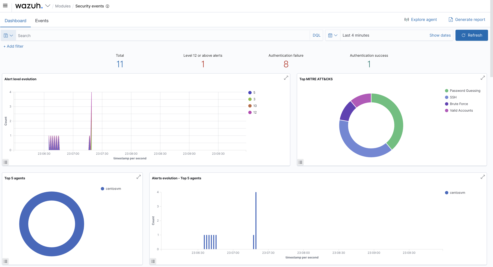

# Threat Simulation & Detection Validation

A detection you haven't tested is a detection you can't trust. This page describes the benign,
self-contained activity used to **validate** that the lab's rules fire as intended, and what each
test should produce on the dashboard.

> **Authorization:** everything here runs against the **local lab machine only** — failed logins
> to `127.0.0.1`, files under `/data`, and a throwaway local user. Run it only on systems you
> own or are authorized to test. Script:
> [`../scripts/simulate_attacks.sh`](../scripts/simulate_attacks.sh).

## Running the tests

```bash
# everything
sudo ./scripts/simulate_attacks.sh --all

# or individually
sudo ./scripts/simulate_attacks.sh --ssh
sudo ./scripts/simulate_attacks.sh --fim
sudo ./scripts/simulate_attacks.sh --audit
```

After running, open the relevant module and set the time range to **Last 15 minutes**.

## Test 1 — SSH brute force

**What it does:** 10 failed SSH logins to `127.0.0.1` with wrong credentials.

**Expected detection:**
- A burst of **authentication failures** in **Security Events**.
- Built-in rules `5710`/`5716` plus the custom escalation `100110` (level 12) when ≥ 6 failures
  come from the same source inside 120 s.
- MITRE techniques: **Password Guessing / Brute Force**, **SSH**, and **Valid Accounts**.

**Evidence from the lab:**

<p align="center">
  
</p>

The summary tiles jump (here: 11 total, 1 level-12+, 8 auth failures vs. 1 success) and the
**Top MITRE ATT&CKS** donut fills with Password Guessing, SSH, Brute Force, and Valid Accounts —
exactly the chain the rules in [custom-rules.md](custom-rules.md) are built to catch.

## Test 2 — File integrity tampering

**What it does:** creates `/data/test.txt` (added), appends to it (modified), and creates then
deletes `/data/test2.txt` (deleted).

**Expected detection:**
- **Integrity Monitoring** events for **added (554)**, **modified (550)**, and **deleted (553)**.
- With `whodata`, the change is attributed to `root`.

See [file-integrity-monitoring.md](file-integrity-monitoring.md) and the FIM dashboard
([`05-file-integrity-monitoring.png`](../assets/images/05-file-integrity-monitoring.png)).

## Test 3 — Account activity

**What it does:** creates and deletes a throwaway local user.

**Expected detection:**
- **System Auditing** events for the `useradd` and `userdel` commands.
- Writes to `/etc/passwd` and `/etc/shadow` picked up by the audit file watches.

See [system-auditing.md](system-auditing.md) and the auditing dashboard
([`06-system-auditing.png`](../assets/images/06-system-auditing.png)).

## Reading the results

For each test, confirm:

1. **The alert fired** — it appears in the module's Events tab at the expected **level**.
2. **It's enriched** — the right MITRE technique and compliance tags are attached.
3. **It's attributable** — correct agent, source IP / user, and file path.

If an expected alert is missing, re-run `wazuh-logtest` on a sample line (see
[log-collection-and-decoders.md](log-collection-and-decoders.md)) to see where decoding or rule
matching broke down — this tight *simulate → observe → tune* loop is the core of detection
engineering.

## The blue-team loop

```
   collect ─▶ normalize ─▶ detect ─▶ correlate ─▶ alert ─▶ investigate ─▶ report
      ▲                                                                      │
      └──────────────────────  tune rules / decoders  ◀──────────────────────┘
```

Simulation closes the loop: it proves the left-hand side (collection → alerting) works, and it
surfaces the gaps that feed back into rule and decoder tuning.
